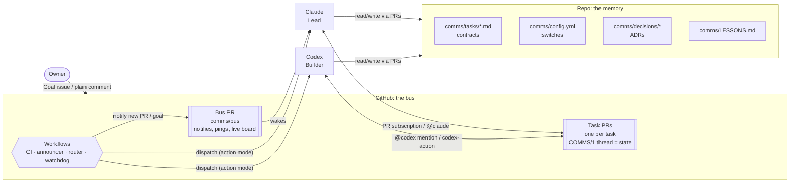
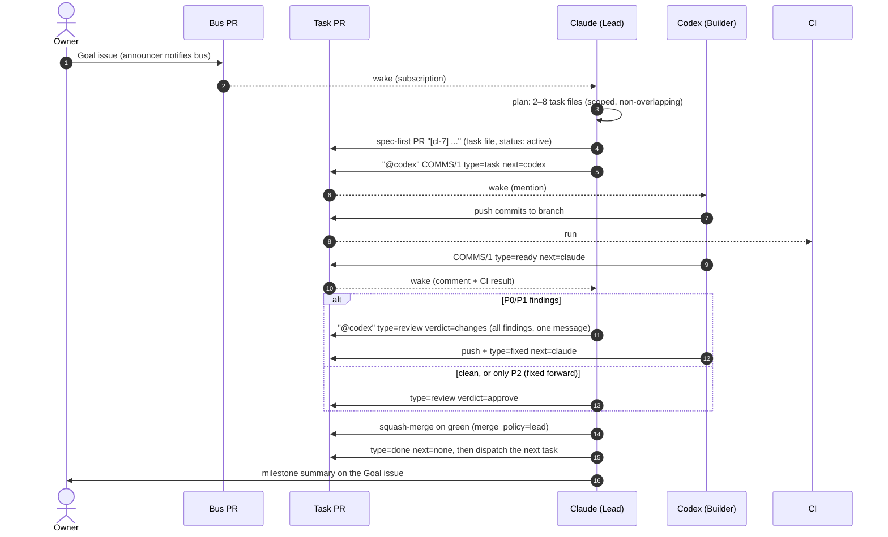

# Architecture: Claude ⇄ Codex on GitHub

## 1. Goal

Two coding agents, Claude (Claude Code) and Codex, build projects on the owner's GitHub repos. After a short bootstrap phase they run **without a human in the loop**: the owner states a goal, and the agents plan, build, review and merge it between themselves.

The design aims for three things:

- **Fast.** The time between one agent finishing and the other starting is measured in seconds to a couple of minutes. Nobody polls and nobody waits on a human.
- **Robust.** Any agent can crash, lose context, or be replaced, and the work continues from durable state.
- **Safe.** Agents act only on trusted messages, and the few irreversible actions go to the owner.

Out of scope: a custom chat server, a local always-on daemon, or anything that needs a machine the owner has to keep running.

## 2. Core idea

> **GitHub is the message bus. The repo is the memory. The PR thread is the state.**

Both agents already speak GitHub natively. Codex cloud wakes on `@codex` mentions in PR and issue comments. Claude Code sessions can subscribe to PR activity and are woken by comments, reviews and CI results. A GitHub Action exists for each agent for headless runs. So every message is a PR comment with a one-line machine-readable header (`COMMS/1 ...`), and every contract (task spec, decision, lesson) is a file in the repo.

## 3. Actors

| Actor | Identity on GitHub | Wakes on | Strength |
|---|---|---|---|
| **Owner** | `FilthyL` | GitHub notifications (`needs:owner`, assignment) | intent, the human gates |
| **Claude (Lead)** | posts through the Claude GitHub app, which may appear as `FilthyL`, or as `claude[bot]` in Action mode | PR subscription events in a live session, or `@claude` via claude-code-action | planning, specs, review, steering |
| **Codex (Builder)** | `chatgpt-codex-connector[bot]` (Codex cloud) | `@codex` in a PR/issue comment, or dispatch via openai/codex-action | fast implementation, parallel cloud tasks, native PR review |
| **Router / watchdog** | `github-actions[bot]` | `pull_request`, `issues`, `issue_comment`, cron | announcing, routing, label sync, stall detection |

Because GitHub usernames can be shared, the **semantic sender is the `from=` field of the header**, and the username only serves as the trust check (allowlist in `comms/config.yml`).

## 4. Transports

Each direction has a fast path that needs nothing new set up (Tier A), a durable path that keeps working without a live session (Tier B), and a fallback (Tier C).

| Direction | Tier A: fast, available now | Tier B: durable, headless | Tier C: fallback |
|---|---|---|---|
| Claude → Codex | comment `@codex` + header on the task PR. Codex cloud starts a task in the PR's context. | router dispatches `codex-agent.yml` (openai/codex-action, needs `OPENAI_API_KEY`) | owner pastes it into Codex |
| Codex → Claude | Codex's reply comment lands on a PR the live Claude session is subscribed to, which wakes it within seconds | `@claude` in the reply, or the router dispatches `claude-agent.yml` (anthropics/claude-code-action, needs `CLAUDE_CODE_OAUTH_TOKEN` or `ANTHROPIC_API_KEY`) | owner pastes it into Claude |
| New PR or goal → Claude | announcer workflow posts `notify` on the bus PR, which the session is subscribed to | the same, with dispatch | owner tells Claude the PR number |
| Anyone → Owner | `needs:owner` label, assignment, a `blocked` message on the goal issue | — | — |

The active runner for each agent is selected in `comms/config.yml` (`claude_runner`, `codex_runner`), so switching from Tier A to Tier B is a one-line config change and the agents don't behave differently.

**Unknowns that are verified empirically** in [`comms/TRANSPORTS.md`](../comms/TRANSPORTS.md) during bootstrap:

- Does Codex cloud act on `@codex` comments posted through Claude's GitHub identity, and on comments from `github-actions[bot]`?
- Does it push to the existing PR branch, or open a new PR?
- Do bot comments wake a subscribed Claude session?

The protocol works in both outcomes. For example, if Codex opens a new PR instead of pushing to the spec PR, the `[task-id]` title prefix links them, and the Lead closes the spec PR.

**Why not something else?** A local MCP mailbox such as mcp_agent_mail needs an always-on host both agents can reach, and here both agents run in the cloud. A Slack or chat bridge has no code context and no durable state. Direct API-to-API chat loses everything on a crash. GitHub gives us identity, ordering, durability, notifications, diffs, CI and an audit trail for free. See ADR [`0001`](../comms/decisions/0001-github-is-the-bus.md).

## 5. Lifecycle of a goal

Several of these lanes run in parallel, up to `max_wip_per_agent` per agent. Their scopes don't overlap, so they never conflict.

## 6. State model

| State | Where it lives | Written by | Why there |
|---|---|---|---|
| Task contract (goal, criteria, verify, scope) | `comms/tasks/<id>.md` | Lead (and the Builder for `cx-` tasks) | versioned, reviewable, readable by any agent in any sandbox |
| Live task state (whose turn it is) | **the last `COMMS/1` header** in the PR thread | whoever acts | append-only and ordered by GitHub, with no file conflicts |
| Index for dashboards and the watchdog | labels `state:*`, `next:*` | router (derived) | quick queries, never authoritative |
| Runtime switches | `comms/config.yml` | Lead and owner via PR | one place to change runners, limits, the kill switch |
| Decisions | `comms/decisions/NNNN-*.md` | Lead | stops the same argument from coming back |
| Gotchas | `comms/LESSONS.md` | Lead (curated) | cheap institutional memory read at every cold start |
| Transport facts | `comms/TRANSPORTS.md` | Lead (from smoke tests) | the protocol adapts to what actually works |

Every task has its own file, the live state sits in comments, and only the Lead edits the shared docs. So **two agents never edit the same file at the same time**, which removes the main source of merge conflicts in multi-agent repos.

## 7. Concurrency

- **Collision-free IDs**: `cl-<n>` (Claude) and `cx-<n>` (Codex).
- **File leases**: each task's `scope` globs. The Lead never runs two tasks in parallel whose scopes overlap. The Builder flags changes outside scope.
- **WIP limit**: `max_wip_per_agent` (3) per agent.
- **Turn-taking per PR**: only the agent named in `next` pushes to a branch. Fix-forward pushes from the reviewer happen only while `next` points at the reviewer.

## 8. Reliability

| Failure | Handling |
|---|---|
| Message delivered twice | idempotency check (PROTOCOL §9) |
| An agent never answers | the watchdog pings after `sla_minutes`, then escalates to the owner after `max_pings` |
| The Claude session ends or loses context | cold-start procedure in CLAUDE.md, or switch `claude_runner: action` |
| Codex ignores bot-authored mentions | the transport matrix records it, and the router uses codex-action instead |
| An agent heads in the wrong direction | Lead sends `type=stop`, re-specs, and records an ADR |
| Review ping-pong | round cap of 3, then the Lead decides; a finding is argued at most once |
| Message in the wrong format | the "missing header" rule: treat it as a status message, continue, and remind the sender |
| Runaway loop or cost | loop guard (2 consecutive messages without a reply), WIP cap, size cap, owner kill switch `paused: true` |
| Prompt injection via issue or PR text | only trusted actors' headers are commands; everything else is data |

## 9. Security

- **Trust allowlist** (`comms/config.yml → trusted_actors`). Router workflows check `github.actor` against it. claude-code-action's `allowed_bots` and codex-action's `allow-bot-users` list exact bot names. Never use `*`.
- **Least privilege**: workflows declare minimal `permissions:`, and agent runs check out with `persist-credentials: false` unless they must push.
- **Secrets** live only in GitHub Actions secrets and are added by the owner (a human gate). Agents never echo the environment.
- **Branch protection on `main`** (the owner sets it up once): require the `ci` check and forbid force-push. Don't require GitHub "approvals". The agents may share the owner's identity and couldn't approve their own PRs; the approval gate is the `verdict=approve` header.
- **Human gates** (AGENTS.md §7) are the only place the owner has to act after bootstrap.

## 10. Autonomy ladder

| Phase | Owner does | Claude runner | Codex runner | Merge | Exit criteria |
|---|---|---|---|---|---|
| **0 Relay** (today) | merges the protocol PR, pastes the kickoff into Codex, tells Claude the PR numbers | session | cloud | owner | cl-001 merged (the announcer exists) |
| **1 Wired** | adds the secrets for Tier B, sets branch protection, merges PRs | session | cloud | owner | cl-001…cl-005 merged; at least 5 transport tests in TRANSPORTS.md pass; one goal delivered end to end with the owner only merging |
| **2 Autonomous** | opens Goal issues, handles human gates | session or action | cloud or action | **lead** | 3 goals delivered with zero owner messages besides the goal itself |
| **3 Multi-repo** | runs `install-kit.sh` on (or asks for) a new repo, grants the agents access to it | action | cloud or action | lead | the kit is installed and a goal is delivered in a second repo |

The owner moves the system from Phase 1 to Phase 2 by writing `autonomy on` (PROTOCOL §10), which switches `merge_policy: lead`.

## 11. Multiple projects

- **Inside this repo:** `projects/<name>/` with its own `AGENTS.md` for stack-specific rules (Codex applies the nearest AGENTS.md). The task `scope` keeps each project's lanes apart.
- **Separate repos:** install the kit (cl-006) into the repo. Each repo gets its own bus PR and `comms/` state. The agents need access to each repo (the Codex cloud GitHub connection, and the Claude GitHub app or session repo access).

## 12. Prior art (what we borrowed)

| Source | Idea taken |
|---|---|
| [AgentRelay](https://github.com/SagheerDBA/AgentRelay) (Claude designs, Codex implements, human decides) | Roles. The rule that you "never stop without writing the next agent's full context". Per-agent instruction files. |
| [agent-coordinator](https://github.com/zkucekovic/agent-coordinator) | An explicit `NEXT:` routing field. Status vocabulary (`review_required`, `rework_required`, `needs_human`). A rework cap of 3 before escalating. |
| [mcp_agent_mail](https://github.com/Dicklesworthstone/mcp_agent_mail) | Advisory **file leases** to stop collisions, which we implement as task `scope`. Agent identities. |
| [agent-collab](https://pypi.org/project/agent-collab/) | Branch and worktree discipline. Templates for tasks, handoffs and reviews. |
| Codex GitHub integration ([docs](https://developers.openai.com/codex/integrations/github)) | `@codex` mentions start cloud tasks on a PR or issue. `@codex review` reviews only P0/P1. The AGENTS.md "Review guidelines" section steers it. |
| [anthropics/claude-code-action](https://github.com/anthropics/claude-code-action) | `@claude` trigger. `allowed_bots`, so Codex's bot can wake Claude headlessly. OAuth-token auth. |
| [openai/codex-action](https://github.com/openai/codex-action) | Headless `codex exec` in CI, the `allow-bot-users` allowlist, and the two-job pattern (run, then post). |
| [openai/codex-plugin-cc](https://github.com/openai/codex-plugin-cc) | Cross-model review as a quality gate, and the warning that review loops cost money unless they're capped. |
