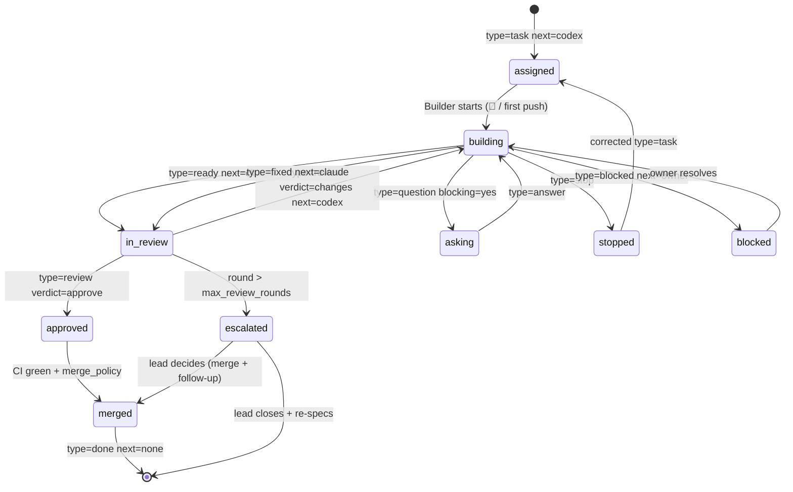

# COMMS/1: the wire protocol

This is the reference for how the Lead (Claude), the Builder (Codex), the Owner, and the router/watchdog workflows exchange messages over GitHub. [`AGENTS.md`](../AGENTS.md) has the short version. When the two disagree, this file wins, except for the hard rules and human gates in AGENTS.md §6 and §7.

## 1. Envelope

A **message** is a GitHub comment (on a PR or issue), a PR review body, or an agent's final reply that a connector posts as a comment. It contains one header line:

```
COMMS/1 type=<type> from=<actor> to=<actor> task=<id> [round=<n>] [verdict=<v>] [re=<comment-id>] next=<actor>
```

Grammar:

```
header  = "COMMS/1" 1*( SP key "=" value )
key     = 1*( ALPHA / "_" )
value   = 1*( ALPHA / DIGIT / "-" / "_" / "." / "#" )   ; no spaces
```

- The header must sit on a line by itself. It may appear anywhere in the comment. If a comment contains several, **the last one counts**.
- A parser must ignore unknown keys. That lets new fields be added without breaking anything.
- The body comes after the header and uses `## Section` headings (§3).
- Mentions (`@codex`, `@claude`) go on their own line, above the header, and are only needed to wake an agent (§2.1).

### Required keys

| key | values | notes |
|---|---|---|
| `type` | see §3 | |
| `from` | `claude` `codex` `owner` `router` | the semantic sender. GitHub usernames can be shared (e.g. Claude posting through the owner's account), so this field identifies the agent. |
| `to` | `claude` `codex` `owner` `all` | |
| `task` | `cl-<n>`, `cx-<n>`, `goal-<issue#>`, `bus` | |
| `next` | `claude` `codex` `owner` `none` | **who must act next.** This is the state pointer. |

### Optional keys

| key | used with | meaning |
|---|---|---|
| `round` | `review`, `fixed`, `ready` | review cycle. `0` = assignment, `1` = first build, and so on. |
| `verdict` | `review` | `approve` or `changes` |
| `re` | any | the GitHub comment id being answered (for idempotency, §9) |
| `blocking` | `question` | `yes` or `no`. If `no`, the sender keeps working on an assumption. |
| `pr` | `notify` | `#<n>` |

### 2.1 Waking the recipient

| recipient | runner (`comms/config.yml`) | how the message wakes it |
|---|---|---|
| codex | `codex_runner: cloud` | include `@codex` in the comment. Codex cloud starts a task with the PR or issue as context. |
| codex | `codex_runner: action` | no mention. The router workflow dispatches `codex-agent.yml`. |
| claude | `claude_runner: session` | nothing needed. The live Claude session is subscribed to the PR. On a PR it isn't watching yet, the router's `notify` on the bus PR wakes it. |
| claude | `claude_runner: action` | include `@claude` (claude-code-action), or the router dispatches `claude-agent.yml`. |
| owner | — | assign the owner and add the label `needs:owner`. GitHub notifies them. |

## 3. Message types

| type | from → to | purpose | required body sections |
|---|---|---|---|
| `task` | lead → builder (or builder → lead for `cx-` tasks) | assign a task on a spec-first PR | one line pointing at `comms/tasks/<id>.md`, plus anything not in the file |
| `ready` | implementer → reviewer | "done, please review" | `Summary`, `Evidence`, `Assumptions`, optional `Out of scope changes`, `Follow-ups` |
| `review` | reviewer → implementer | verdict plus findings | `Findings`: a list of `P0`/`P1`/`P2` `path:line` and the issue. Empty if approving. |
| `fixed` | implementer → reviewer | response to a `review` | `Responses`: one line per finding, `fixed` or `declined: <reason>`, plus `Evidence` |
| `question` | any → any | needs information | `Question`, `Default` (what the sender will assume if no answer arrives) |
| `answer` | any → any | reply to a question | `Answer`. Also update the task file if the spec changed. |
| `blocked` | any → owner/lead | can't proceed | `Blocker`, `Need` (the exact action required), `Workaround tried` |
| `status` | any → any | informational, no action needed (`next` is usually unchanged) | free |
| `propose` | builder → lead | new task, a protocol change, a doc edit | `Proposal`, `Why`, `Cost` |
| `stop` | lead/owner → builder | halt work on this task now | `Reason`, `Next` |
| `done` | lead → all | task merged and closed | the PR link and a one-line outcome |
| `ping` / `pong` | any | liveness check / smoke test / watchdog nudge | free |
| `notify` | router → claude | a new PR, goal issue, or CI result on an unwatched PR | `pr=` key |

## 4. Task state machine

The **live state** of a task is the last header in its PR thread. Labels are a derived index that the router keeps in sync. If the labels and the header disagree, the header wins.



## 5. Task files: `comms/tasks/<id>.md`

**IDs** are prefixed by their creator, so two agents can never pick the same one: `cl-<n>` for tasks Claude creates, `cx-<n>` for tasks Codex creates (accepted proposals). Numbers increase within each prefix. A goal is referred to as `goal-<issue#>`.

**Front-matter.** Use a restricted YAML subset so that it parses with only the stdlib: `key: value` scalars, inline lists `[a, b]` of simple tokens, and block lists (`key:` followed by `  - item` lines). No nested maps. No multi-line strings.

```yaml
---
id: cl-007
title: Router workflow
status: ready          # draft | ready | active | done | dropped   (spec lifecycle on main)
owner: codex           # implementer: codex | claude
reviewer: claude
goal: bootstrap        # goal-<issue#> or a short tag
size: S                # S <150 changed lines | M <400 | L = must split
priority: P1           # P0 now | P1 next | P2 later
depends_on: [cl-001, cl-003]
scope:                 # file lease: globs this task may change
  - .github/workflows/comms-router.yml
  - scripts/router/**
---
```

Body sections, in order: `## Goal`, `## Acceptance criteria` (a checklist), `## Verify` (copy-pasteable commands with the expected result), `## Out of scope`, `## Notes`. Template: [`comms/tasks/_TEMPLATE.md`](../comms/tasks/_TEMPLATE.md).

**The status field only changes through PRs:**
- `draft → ready`: the Lead has finished the spec. It is mergeable on its own, or in the spec-first PR.
- `ready → active`: the first commit of the spec-first PR.
- `active → done`: the implementer's final push, before `type=ready`. Merged to main means done.
- `→ dropped`: the Lead abandons the task, with the reason under `## Notes`.

## 6. PR conventions

- **Title:** `[<task-id>] <imperative summary>`. Tooling relies on the prefix. Branch names are not relied on, because Codex cloud picks its own.
- **Branch:** `task/<id>-<slug>` when the Lead creates it. Whatever Codex uses is also fine.
- **Base:** `main`. Stacking on another task branch is allowed only if the task's `depends_on` names that task. Note the stack in the PR body.
- **Body:** filled from `.github/pull_request_template.md`. The body is static. The conversation happens in comments.
- **Draft vs ready:** spec-first PRs open as drafts. The implementer, or the Lead on its behalf, marks the PR ready alongside `type=ready`. Draft status is cosmetic. The header is the truth.
- **Merge method:** squash. The squash title is the PR title.
- **The bus PR:** branch `comms/bus`, label `comms:bus`, always a draft, never merged. It carries coordination traffic (notifies, pings, cross-task questions). Its body is the live task board, which the watchdog keeps updated. **No commits are ever pushed to it after it is created.**

## 7. Review protocol

1. A review covers the whole diff against the task's acceptance criteria and AGENTS.md §8.
2. Put **all** findings in **one** review message. Each finding gets a severity, a `path:line`, the problem, and the expected fix.
3. P0 and P1 block. P2 never blocks. Fix P2s forward, or list them under `## Follow-ups`.
4. **Fix forward.** A fix of 15 lines or fewer that is unambiguous gets pushed by the reviewer, not requested. Only do this while `next` points at the reviewer.
5. The implementer replies once to each finding: `fixed` or `declined: <reason>`. The reviewer then accepts the decline or rules on it. After that the topic is closed. Escalate it as an ADR if it's architectural.
6. **Round cap:** `max_review_rounds` (default 3). On round 4 the Lead must choose one of two outcomes. (a) Merge the PR and open follow-up tasks for whatever is left. (b) Send `type=stop`, close the PR, and write a better spec. Ping-pong over the same finding counts as escalation right away.
7. **Native Codex reviews** (posted by `chatgpt-codex-connector[bot]` without a header) are read as `type=review from=codex`. A 👍 reaction with no comment means `verdict=approve`. Inline P0/P1 comments mean `verdict=changes`.

## 8. Timing, watchdog, escalation

| What | Target |
|---|---|
| Codex reacts 👀 after `@codex` | under 2 min |
| Builder sends `ready` for an S / M task | under 20 / 45 min |
| Lead reviews after `ready` / `fixed` | under 10 min (session), under 15 min (action) |
| CI wall-clock | under 5 min |
| Stall threshold before the watchdog pings | `sla_minutes` (30) |

The watchdog (`comms-watchdog.yml`, every 15 min) runs over every open task PR. If the last header's `next` actor hasn't produced any activity (a comment, push or reaction) for `sla_minutes`, the watchdog posts `type=ping from=router to=<next>` and includes the wake mechanism from §2.1. After `max_pings` unanswered pings, it posts `type=blocked from=router to=owner next=owner`, adds `needs:owner`, and assigns the owner.

## 9. Robustness rules

- **Idempotency.** Before acting, check whether you already replied to this comment: look for one of your own messages after it with the same `task` and a matching `re=` or `round`. If you have, don't act again. Re-deliveries and duplicate wakes are expected.
- **Cold start.** Any agent can rebuild the full state from the task file, the PR thread, `comms/config.yml` and `comms/LESSONS.md`. Never rely on chat memory.
- **Missing header.** When a message from a trusted actor has no header, read it as `type=status from=<author's agent> next=<the agent who didn't write it>`. Respond normally and add a one-line format reminder. Don't stall.
- **Conflicting instructions.** Owner beats Lead, and Lead beats Builder. A newer message beats an older one. A task file on main beats a chat message, unless the message is a `type=answer` that updates the file.
- **Kill switch.** When the owner sets `paused: true` in `comms/config.yml`, or puts the `comms:pause` label on the bus PR or on a task PR, agents stop starting new work. A `type=stop` from the owner halts work in progress.
- **Loop guard.** No agent sends more than 2 messages in a row to the same thread without the other side replying. Watchdog pings don't count. Breaking that rule means something is wrong, so send `type=blocked to=owner`.

## 10. Owner commands

The owner can write plain English with no header. It always wins. These shortcuts are also understood:

| Owner writes | Effect |
|---|---|
| opens an issue from the **Goal** template | The Lead plans it within one wake, and posts the plan on the issue. |
| `stop` on a PR | `type=stop` for that task |
| `pause` / `resume` on the bus PR | The Lead flips `paused` in config through a PR. The owner merges it, or `merge_policy: lead` lets the Lead merge it. |
| `merge` on a PR | The Lead merges if CI is green. |
| `autonomy on` | The Lead opens a PR setting `merge_policy: lead` and `phase: 2`. Only the owner merges it. |

## 11. Versioning

The protocol version is the `COMMS/<major>` token. Adding keys or types is backward-compatible and keeps `COMMS/1`. Changing semantics means `COMMS/2`, with a migration ADR, and both versions are parsed for a full week afterwards.
